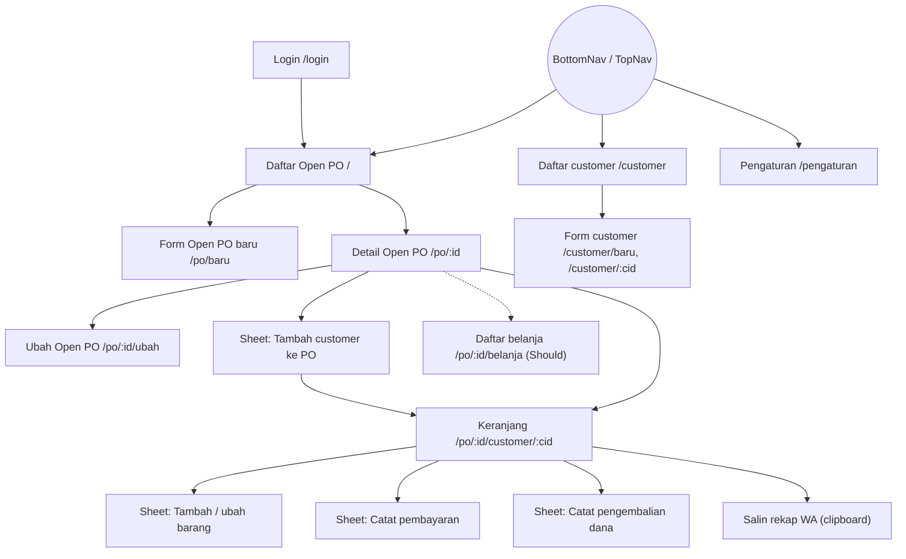
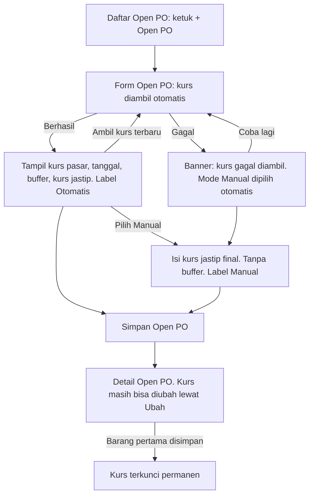

# Spesifikasi UI/UX — Aplikasi Jastip (MVP)

Status: desain v1 disetujui user, 25 Okt 2026 (palet warna disetujui; hapus pembayaran salah input ditambahkan). Preview statis: [`preview/preview-desain-jastip.png`](preview/preview-desain-jastip.png). Sumber scope: [`docs/product/scope-mvp.md`](../product/scope-mvp.md) (scope freeze 27 Okt 2026).
Pengguna: admin tunggal, kebanyakan di HP (lebar acuan 360px), sering satu tangan.
Dokumen ini tidak berisi kode produksi. Nama kelas Tailwind di bawah adalah petunjuk untuk front-end, bukan markup final.

Bagian bertanda **(Should)** baru dikerjakan setelah semua fitur Must selesai.

---

## 1. Prinsip desain

1. **Satu layar, satu tugas utama.** Tombol utama selalu di bawah layar, dalam jangkauan jempol.
2. **Warna untuk status, bukan hiasan.** Latar krem polos, tanpa ilustrasi, gradien, atau bayangan pada kartu. Setiap status selalu tampil sebagai teks + ikon, warna hanya pelengkap.
3. **Yang dilihat admin sama dengan yang diterima customer.** Label dan angka di ringkasan keranjang memakai istilah yang sama dengan teks rekap WA.
4. **Cegah salah input sebelum tersimpan.** Pratinjau harga sebelum simpan, nominal tertulis di tombol simpan pembayaran, peringatan sebelum kurs terkunci.
5. **Tahan sinyal lemah.** Pratinjau harga dihitung di perangkat. Isi form tidak hilang saat simpan gagal.

---

## 2. Palet warna

Semua warna didaftarkan sebagai token custom di konfigurasi Tailwind (lihat §12.1), supaya hex-nya pasti sama di Tailwind v3 maupun v4. Nama token = nama kelas utilitas (`bg-page`, `text-ink`, dst.).

### 2.1 Warna dasar

| Token | Hex | Contoh kelas | Dipakai untuk |
|---|---|---|---|
| `page` | `#FBF7EB` | `bg-page` | Latar halaman (krem/ivory lembut) |
| `surface` | `#FFFDF8` | `bg-surface` | Latar kartu, input, sheet, dialog |
| `ink` | `#2B2620` | `text-ink` | Teks utama, angka |
| `ink-muted` | `#5E5648` | `text-ink-muted` | Teks sekunder, label kecil, baris Kosong |
| `ink-subtle` | `#736A5A` | `placeholder:text-ink-subtle` | Placeholder, teks bantuan, teks tombol nonaktif |
| `line` | `#E6DFCC` | `border-line` | Garis pemisah dan bingkai kartu (dekoratif) |
| `line-strong` | `#8A8070` | `border-line-strong` | Bingkai input, tombol sekunder, chip (wajib ≥3:1) |
| `primary` | `#2F6D5F` | `bg-primary`, `text-primary`, `outline-primary` | Tombol utama, tautan, focus ring, nav aktif (hijau sage-teal kalem) |
| `primary-hover` | `#26594D` | `hover:bg-primary-hover` | Hover/pressed tombol utama |
| `primary-soft` | `#E3EEEA` | `bg-primary-soft` | Badge "Buka", latar item nav aktif |
| `danger` | `#A33A2A` | `bg-danger`, `text-danger`, `border-danger` | Tombol hapus, teks dan bingkai error |
| `danger-hover` | `#8A3324` | `hover:bg-danger-hover` | Hover/pressed tombol bahaya |
| Putih | `#FFFFFF` | `text-white` | Teks di atas `primary` / `danger` |

Backdrop sheet/dialog: `bg-ink/40` (ink 40% opacity).

### 2.2 Warna status

Setiap status punya pasangan latar (`-bg`) dan teks (`-fg`). Nama token mengikuti nilai status di API supaya pemetaannya langsung.

| Status | Token | Latar | Teks | Ikon (Heroicons v2) | Tampilan |
|---|---|---|---|---|---|
| Belum bayar | `belum-bayar` | `#F6E3DE` | `#8A3324` | `clock` | badge terakota muda |
| Kurang DP | `kurang-dp` | `#F5EACB` | `#75550F` | `exclamation-triangle` | badge oker muda |
| DP | `dp` | `#E2EAF3` | `#2E5378` | `banknotes` | badge biru keabuan |
| Lunas | `lunas` | `#E1EEDF` | `#2F5E2E` | `check-circle` | badge hijau daun muda |
| Lebih bayar | `lebih-bayar` | `#ECE3F0` | `#5E3A6E` | `arrow-uturn-left` | badge ungu plum muda |
| Kosong (baris) | `kosong` | `#ECE8E0` | `#5E5648` | `no-symbol` | badge abu hangat; teks baris jadi `ink-muted`, rincian qty dicoret |

Contoh kelas badge: `bg-lunas-bg text-lunas-fg`.

Pasangan yang sama dipakai ulang untuk banner, supaya jumlah token tetap kecil:

| Kebutuhan | Pakai token |
|---|---|
| Banner peringatan (mis. kurs gagal diambil) | `kurang-dp` |
| Banner info (mis. kurs akan terkunci) | `dp` |
| Banner sukses | `lunas` |
| Badge netral: "Terkunci", "Selesai", "Otomatis", "Manual", latar tombol nonaktif | `kosong` |
| Error | `danger` (teks/bingkai) di atas `surface` |

Aturan: warna status hanya dipakai di badge dan banner. Angka uang selalu `text-ink`, tidak diwarnai.

### 2.3 Rasio kontras (WCAG 2.1)

Dihitung dengan rumus relative luminance WCAG 2.1, **dibulatkan ke bawah** ke 1 desimal supaya tidak ada yang "lolos karena pembulatan". Syarat: teks normal ≥4,5:1, komponen non-teks (bingkai input, focus ring) ≥3:1.

| Depan | Belakang | Rasio | Hasil |
|---|---|---|---|
| `ink` #2B2620 | `page` #FBF7EB | 13,9:1 | AA/AAA |
| `ink` #2B2620 | `surface` #FFFDF8 | 14,7:1 | AA/AAA |
| `ink-muted` #5E5648 | `page` | 6,7:1 | AA |
| `ink-muted` #5E5648 | `surface` | 7,1:1 | AA/AAA |
| `ink-subtle` #736A5A | `page` | 4,9:1 | AA |
| `ink-subtle` #736A5A | `surface` | 5,2:1 | AA |
| Putih | `primary` #2F6D5F | 6,0:1 | AA |
| Putih | `primary-hover` #26594D | 8,0:1 | AA/AAA |
| `primary` #2F6D5F (tautan, focus ring) | `page` | 5,6:1 | AA |
| `primary` #2F6D5F | `surface` | 5,9:1 | AA |
| `primary` #2F6D5F | `primary-soft` #E3EEEA | 5,0:1 | AA |
| Putih | `danger` #A33A2A | 6,5:1 | AA |
| Putih | `danger-hover` #8A3324 | 8,1:1 | AA/AAA |
| `danger` #A33A2A (teks error) | `surface` | 6,4:1 | AA |
| `danger` #A33A2A | `page` | 6,1:1 | AA |
| `surface` #FFFDF8 (teks toast) | `ink` #2B2620 | 14,7:1 | AA/AAA |
| Badge Belum bayar #8A3324 | #F6E3DE | 6,5:1 | AA |
| Badge Kurang DP #75550F | #F5EACB | 5,7:1 | AA |
| Badge DP #2E5378 | #E2EAF3 | 6,5:1 | AA |
| Badge Lunas #2F5E2E | #E1EEDF | 6,3:1 | AA |
| Badge Lebih bayar #5E3A6E | #ECE3F0 | 7,2:1 | AA/AAA |
| Badge Kosong #5E5648 | #ECE8E0 | 5,9:1 | AA |
| `line-strong` #8A8070 (bingkai input) | `surface` | 3,8:1 | ≥3:1 non-teks |
| `line-strong` #8A8070 | `page` | 3,6:1 | ≥3:1 non-teks |
| `ink-subtle` (teks tombol nonaktif) | `kosong-bg` #ECE8E0 | 4,3:1 | Dikecualikan WCAG 1.4.3 (komponen nonaktif); selalu disertai teks penjelas berwarna `ink-muted` |

`line` #E6DFCC hanya dekoratif (pemisah kartu). Jangan dipakai sebagai satu-satunya bingkai input atau tombol.

---

## 3. Tipografi, spasi, radius

### 3.1 Tipografi

Font: system font stack bawaan Tailwind (`font-sans`). Tanpa web font, supaya ringan di data seluler. Semua angka uang memakai `tabular-nums` agar kolom rata.

| Gaya | Ukuran / tinggi baris | Tebal | Kelas | Dipakai untuk |
|---|---|---|---|---|
| Judul halaman | 20 / 28px | 600 | `text-xl font-semibold` | Judul di app bar |
| Judul bagian | 18 / 28px | 600 | `text-lg font-semibold` | "Barang", "Riwayat pembayaran" |
| Angka besar | 24 / 32px | 600 | `text-2xl font-semibold tabular-nums` | Kurs jastip, Sisa pelunasan |
| Isi | 16 / 24px | 400 | `text-base` | Teks isi, nilai input, tombol |
| Isi tebal | 16 / 24px | 600 | `text-base font-semibold` | Nama barang, nama customer, subtotal |
| Label | 14 / 20px | 500 | `text-sm font-medium` | Label input |
| Kecil | 14 / 20px | 400 | `text-sm` | Teks sekunder, bantuan, badge, chip |

Aturan:
- Ukuran minimum 14px. Tidak ada teks 12px.
- Nilai di dalam input minimal 16px (mencegah zoom otomatis di iOS Safari).
- Judul tidak memakai huruf kapital semua. Huruf kapital hanya di label status rekap WA.

### 3.2 Spasi (skala Tailwind 4px)

| Pemakaian | Mobile | ≥ `md` |
|---|---|---|
| Padding horizontal halaman | 16px `px-4` | 24px `md:px-6` |
| Padding dalam kartu | 16px `p-4` | 16px |
| Jarak antar-bagian | 24px `space-y-6` | 24px |
| Jarak antar-field form | 16px `space-y-4` | 16px |
| Label ke input | 4px `mt-1` | 4px |
| Jarak antar-tombol berdampingan | 8px `gap-2` | 12px `md:gap-3` |
| Padding bawah konten saat ada FAB / sticky bar | 112px `pb-28` | 24px |

### 3.3 Radius dan elevasi

| Elemen | Radius | Kelas |
|---|---|---|
| Tombol, input | 8px | `rounded-lg` |
| Kartu, dialog | 12px | `rounded-xl` |
| Bottom sheet (sudut atas) | 16px | `rounded-t-2xl` |
| Badge, chip, FAB | penuh | `rounded-full` |

Kartu tidak memakai bayangan, cukup `bg-surface border border-line`. Bayangan hanya untuk lapisan di atas konten: sheet/dialog `shadow-lg`, FAB `shadow-md`. Sticky bar memakai `border-t border-line`, tanpa bayangan.

### 3.4 Ikon

Heroicons v2 (MIT, dari tim Tailwind). Outline 24px untuk navigasi dan tombol, versi 16px untuk badge. Ikon selalu `aria-hidden="true"` dan didampingi teks. Boleh diganti set lain asalkan bentuknya setara.

---

## 4. Komponen dasar

Nama komponen di kolom pertama dipakai sama persis di Figma dan di kode front-end.

### 4.1 Tombol

| Komponen | Tampilan | Kelas inti |
|---|---|---|
| `Button/Primary` | Latar `primary`, teks putih, tebal | `h-11 px-4 rounded-lg bg-primary text-white font-semibold hover:bg-primary-hover` |
| `Button/Secondary` | Latar `surface`, bingkai `line-strong`, teks `ink` | `h-11 px-4 rounded-lg bg-surface border border-line-strong text-ink font-semibold hover:bg-page` |
| `Button/Danger` | Latar `danger`, teks putih | `h-11 px-4 rounded-lg bg-danger text-white font-semibold hover:bg-danger-hover` |
| `Button/Ghost` | Tanpa latar, teks `primary` (untuk aksi ringan seperti "Rincian hitungan", "Coba lagi") | `h-11 px-3 rounded-lg text-primary font-semibold hover:bg-primary-soft` |
| `Button/Icon` | Ikon 24px dalam area 44×44px, wajib `aria-label` | `h-11 w-11 rounded-lg` |
| `FAB` | Tombol utama berlabel ("+ Open PO"), kanan bawah, di atas bottom nav. Hanya di bawah `md`. | `h-14 px-5 rounded-full bg-primary text-white shadow-md` |

State semua tombol:
- **Hover** (hanya perangkat pointer): warna `-hover`.
- **Pressed**: sama dengan hover. Tanpa efek skala.
- **Focus** (keyboard): `focus-visible:outline-2 focus-visible:outline-offset-2 focus-visible:outline-primary`.
- **Nonaktif**: `bg-kosong-bg text-ink-subtle`, tanpa bingkai, `cursor-not-allowed`. Selalu ada teks di dekatnya yang menjelaskan alasannya.
- **Loading**: label berganti ("Menyimpan…") + spinner 16px di kiri, tombol nonaktif sampai respons datang. Mencegah pembayaran tercatat dua kali.

Lebar: tombol utama di mobile `w-full` atau berbagi baris 50:50. Di desktop selebar konten (`md:w-auto`).

### 4.2 Input

| Komponen | Keterangan |
|---|---|
| `Input/Text` | Label di atas (selalu tampil), input `h-11 rounded-lg bg-surface border border-line-strong px-3 text-base`. Placeholder hanya contoh, bukan pengganti label. |
| `Input/Prefix` | Untuk uang: awalan "Rp" atau "AUD" di dalam bingkai, warna `ink-muted`. |
| `Input/Suffix` | Untuk persen: akhiran "%" di dalam bingkai. |
| `Input/Stepper` | Qty: tombol − dan + (masing-masing 44×44px) mengapit input angka. − nonaktif saat qty = 1. |
| `Input/Combobox` | Nama barang dengan daftar saran di bawahnya (pola ARIA combobox). |
| `Input/Search` | Ikon `magnifying-glass` di kiri, tombol hapus isi (`x-mark`) di kanan saat terisi. |
| `Input/Date` | Date picker bawaan browser, nilai awal hari ini (tanggal lokal perangkat). |
| `Input/Textarea` | Alamat, catatan, teks penutup rekap. Minimal 3 baris. |
| `Segmented` | 2 pilihan sejajar (mis. Otomatis / Manual, Buka / Selesai). Pola radio group, tinggi 44px. |

State input:
- **Focus**: bingkai `primary` + outline 2px `primary`.
- **Error**: bingkai `danger`, pesan di bawah input berwarna `danger` dengan ikon `exclamation-circle`, dihubungkan lewat `aria-describedby`, input diberi `aria-invalid="true"`.
- **Read-only** (kurs terkunci): tidak ditampilkan sebagai input. Nilainya ditulis sebagai teks biasa + badge "Terkunci", supaya angka tetap terbaca jelas.
- **Teks bantuan**: di bawah input, `text-sm text-ink-subtle`.

### 4.3 Kartu dan baris

| Komponen | Keterangan |
|---|---|
| `Card` | `bg-surface border border-line rounded-xl p-4` |
| `MoneyRow` | Label kiri (`ink-muted`), nominal kanan (`ink`, `tabular-nums`). Variant `strong` untuk baris penentu (Sisa pelunasan / Kelebihan bayar). |
| `CustomerRow` | Nama + no WA (kiri), total + badge status (kanan). Seluruh baris bisa diketuk, tinggi minimal 64px. |
| `OrderLineRow` | Nama barang, `qty × harga/unit`, subtotal. Variant `kosong`: badge Kosong, teks `ink-muted`, rincian qty dicoret, subtotal diganti "tidak dihitung". |
| `PaymentRow` | Tanggal, jenis ("Pembayaran" / "Pengembalian dana"), nominal, catatan (opsional). Pengembalian ditulis dengan tanda minus: "−Rp384.000". Tombol ikon `trash` 44px di kanan (`ink-muted`, berubah `danger` saat hover/fokus) untuk hapus salah input (§6.7). |
| `KursCard` | Ringkasan kurs PO. Variant: `loading`, `otomatis`, `manual`, `gagal`, `terkunci`. |
| `PricePreview` | Pratinjau harga di form barang (§7.6). Variant: `kosong`, `terisi`, `rincian-terbuka`. |
| `EmptyState` | Satu kalimat penjelasan + satu tombol aksi. Tanpa ilustrasi. |
| `Skeleton` | Balok `bg-kosong-bg rounded` setinggi teks, dipakai saat loading daftar. |

### 4.4 Badge dan chip

| Komponen | Keterangan |
|---|---|
| `StatusBadge` | `inline-flex items-center gap-1 h-6 px-2 rounded-full text-sm font-medium`, ikon 16px + teks. Variant: 5 status pembayaran + Kosong + netral (Terkunci, Otomatis, Manual, Selesai) + Buka (`primary-soft` / `primary`). |
| `FilterChip` | Tinggi 44px di mobile, 36px di `md` ke atas. Belum dipilih: `bg-surface border border-line-strong text-ink`. Terpilih: `bg-primary text-white` + ikon `check` 16px. Selalu menampilkan jumlah, mis. "Lunas 2". Pola: radio group (hanya satu filter aktif). |

### 4.5 Umpan balik dan lapisan

| Komponen | Keterangan |
|---|---|
| `Banner` | Kotak di dalam konten, variant `info` / `warning` / `error` / `success` (warna lihat §2.2), ikon di kiri, teks, opsional satu tombol ghost. Untuk pesan yang harus tetap terlihat (kurs gagal, error jaringan, PO selesai). |
| `Toast` | Hanya untuk konfirmasi sukses. `bg-ink text-surface rounded-lg px-4 py-3`, di tengah bawah, di atas bottom nav / sticky bar. Hilang setelah 4 detik, bisa ditutup. `role="status"`. Error tidak pernah memakai toast. |
| `ConfirmDialog` | Dialog di tengah layar, `max-w-sm`. Judul berupa pertanyaan, 1–2 kalimat penjelasan, dua tombol: "Batal" (secondary, kiri) dan aksi (danger/primary, kanan). `role="alertdialog"`, fokus awal ke "Batal". |
| `Sheet` | Di bawah `md`: bottom sheet selebar layar (maks. `max-w-lg` di `sm`), tinggi maksimal 90dvh, header berisi judul + tombol tutup 44px, isi bisa di-scroll. Di `md` ke atas: dialog tengah `max-w-lg`. Fokus terkunci di dalam, Esc menutup, fokus kembali ke tombol pemicu. |
| `ActionSheet` | Daftar aksi untuk satu baris barang (Ubah, Tandai Kosong / Lepas tanda Kosong, Hapus). Setiap item tinggi 52px dengan ikon + teks. "Hapus" berwarna `danger`. Di `lg` diganti tombol aksi langsung di baris. |

### 4.6 Navigasi

| Komponen | Keterangan |
|---|---|
| `BottomNav` | Di bawah `md`. 3 item: **Open PO** (`shopping-bag`), **Customer** (`users`), **Pengaturan** (`cog-6-tooth`). Tinggi 64px + `env(safe-area-inset-bottom)`. Ikon + label selalu tampil. Item aktif: teks `primary` + latar pil `primary-soft` di belakang ikon, `aria-current="page"`. |
| `AppBar` | Atas, tinggi 56px, `bg-page border-b border-line`. Varian `root`: judul saja. Varian `child`: tombol kembali `‹` (44px, `aria-label="Kembali"`) + judul + subjudul opsional + satu aksi kanan opsional. |
| `TopNav` | `md` ke atas, menggantikan BottomNav. Nama aplikasi di kiri, 3 tautan di tengah/kiri, "Keluar" di kanan. Tautan aktif bergaris bawah 2px `primary`. |
| `StickyActionBar` | Bar aksi di bawah layar Keranjang (hanya di bawah `lg`), `bg-surface border-t border-line`, padding bawah ikut safe area. |

---

## 5. Pola navigasi dan breakpoint

### 5.1 Pola yang dipilih

- **Mobile (< 768px): bottom navigation 3 item** di layar level atas (Daftar Open PO, Daftar customer, Pengaturan). Alasannya: hanya ada 3 tujuan utama dan semuanya terjangkau jempol.
- **Layar turunan** (Detail Open PO, Keranjang, semua form) memakai `AppBar` varian `child` dengan tombol kembali, dan **bottom nav disembunyikan**. Ruang bawah dipakai untuk tombol aksi (FAB atau `StickyActionBar`), supaya layar 360×640 tidak penuh oleh dua bar.
- **Form pendek** yang muncul dari layar lain (tambah customer ke PO, tambah/ubah barang, catat pembayaran, catat pengembalian dana) memakai `Sheet`. Admin tidak kehilangan konteks keranjang.
- **Desktop (≥ 768px): `TopNav`** menggantikan bottom nav. FAB menjadi tombol biasa di header halaman. Sheet menjadi dialog di tengah.

### 5.2 Breakpoint (default Tailwind)

| Lebar | Perubahan tata letak |
|---|---|
| < 640 (dasar, acuan 360px) | 1 kolom, `px-4`. BottomNav di layar level atas. FAB kanan bawah. Sheet selebar layar. Keranjang punya `StickyActionBar`. Chip filter boleh turun ke 2 baris (tidak di-scroll ke samping, supaya semua status terlihat). |
| `sm` ≥ 640 | Konten dan sheet dibatasi `max-w-lg`, di tengah. Selebihnya sama. |
| `md` ≥ 768 | TopNav menggantikan BottomNav. FAB → tombol di header halaman. Sheet → dialog tengah `max-w-lg`. Daftar customer (global dan per PO) menjadi tabel. `md:px-6`. Chip filter 36px. |
| `lg` ≥ 1024 | Detail Open PO dan Keranjang menjadi 2 kolom (lihat wireframe). StickyActionBar hilang, aksinya pindah ke kolom kanan. Form tambah barang tampil sebagai kartu di halaman. ActionSheet baris barang → tombol aksi langsung di baris. Daftar Open PO menjadi grid 2 kolom. |
| `xl` ≥ 1280 | Kontainer `max-w-6xl` (1152px) di tengah. Tidak ada perubahan susunan. |

Lebar konten per jenis halaman (≥ `md`): form dan Pengaturan `max-w-lg`, daftar `max-w-3xl`, Detail Open PO dan Keranjang `max-w-6xl`.

---

## 6. Peta navigasi dan alur utama

### 6.1 Sitemap

Rute di bawah adalah usulan untuk front-end. Silakan disesuaikan dengan struktur proyek.



Semua rute selain `/login` wajib sesi. Akses tanpa sesi diarahkan ke `/login?next=<rute asal>`, dan setelah login admin kembali ke rute asal.

### 6.2 Alur: Login

1. Admin membuka aplikasi → layar Login.
2. Isi nama pengguna dan kata sandi → "Masuk".
3. Berhasil → Daftar Open PO (atau rute `next`).
4. Gagal → pesan umum "Nama pengguna atau kata sandi salah." di atas form, isi kata sandi dikosongkan, fokus ke kata sandi.
5. Sesi berakhir karena tidak aktif → aksi berikutnya diarahkan ke Login dengan banner "Sesi berakhir. Silakan masuk lagi."
6. Keluar: Pengaturan → "Keluar" (mobile) atau TopNav → "Keluar" (desktop) → Login. Tanpa dialog konfirmasi.

Tidak ada tautan daftar akun maupun lupa kata sandi (di luar scope).

### 6.3 Alur: Buat Open PO dan kurs



1. Daftar Open PO → "+ Open PO".
2. Form terbuka dan langsung mengambil kurs (tidak perlu ketuk apa pun).
3. Admin mengisi nama PO. Mata uang tampil sebagai teks tetap "AUD".
4. Kurs:
   - **Otomatis berhasil**: tampil kurs pasar, tanggal kurs, buffer 3%, dan kurs jastip (angka besar). Kurs jastip dihitung oleh API, bukan front-end. "Ambil kurs terbaru" mengulang pengambilan.
   - **Manual**: admin memilih "Manual" di segmented control. Field "Kurs jastip" terisi nilai otomatis terakhir (kalau ada) sebagai titik awal. Teks bantuan: "Angka ini dipakai apa adanya, tanpa buffer."
   - **Gagal**: banner peringatan + tombol "Coba lagi". Mode berpindah ke Manual. PO tidak bisa disimpan sebelum kurs terisi.
5. "Simpan Open PO" → Detail Open PO + toast "Open PO dibuat."
6. Selama belum ada barang, kurs bisa diambil ulang atau diubah lewat Detail Open PO → "Ubah".
7. Saat barang pertama akan disimpan, form barang menampilkan banner info bahwa kurs akan terkunci (§7.6). Setelah tersimpan, kurs terkunci permanen walaupun barangnya kemudian dihapus.

### 6.4 Alur: Tambah customer ke Open PO

1. Detail Open PO → "+ Customer" → Sheet "Tambah customer".
2. Ketik nama atau no WA di kolom cari. Hasil muncul sambil mengetik.
3. **Customer lama**: ketuk baris → Keranjang customer tersebut. Customer yang sudah ada di PO ini bertanda "Sudah di PO ini", dan mengetuknya membuka keranjangnya yang sudah ada.
4. **Customer baru**: ketuk "+ Buat customer baru". Isi form di dalam sheet yang sama. Nama terisi dari teks pencarian, atau no WA kalau yang diketik angka.
   - Kalau no WA sudah terdaftar: peringatan di bawah field "No WA ini sudah terdaftar atas nama Rina." + tombol "Pakai Rina". Admin tetap boleh menyimpan (peringatan, bukan blokir).
   - "Simpan & buka keranjang" → customer tersimpan → Keranjang (kosong).
5. Keranjang kosong langsung menampilkan tombol "Tambah barang".

Catatan: apakah customer tetap muncul di daftar PO kalau admin keluar tanpa menyimpan satu barang pun masih perlu dikonfirmasi (lihat §13, P1).

### 6.5 Alur: Input baris pesanan dengan pratinjau

1. Keranjang → "+ Tambah barang" → Sheet "Tambah barang" (di `lg`: kartu form di halaman).
2. **Nama barang**: saat mengetik, muncul maksimal 6 saran dari barang di PO yang sama, masing-masing dengan harga AUD-nya. Memilih saran mengisi nama dan harga AUD. Markup tidak ikut berubah.
3. **Harga (AUD)**: keyboard desimal. Koma atau titik diterima sebagai pemisah desimal.
4. **Qty**: stepper, nilai awal 1.
5. **Markup**: terisi default dari Pengaturan, bisa diubah.
6. **Pratinjau** diperbarui setiap kali input berubah: harga/unit, subtotal, dan satu baris kecil "Kurs Rp13.054 · markup 10%". "Rincian hitungan" (tertutup secara default) menampilkan langkah pembulatan.
7. "Simpan" → sheet tertutup, baris muncul di daftar, ringkasan keranjang diperbarui, toast "Barang A disimpan."
   "Simpan & tambah lagi" → form dikosongkan (markup kembali ke default), fokus ke Nama barang, toast yang sama.
8. **Ubah baris**: ketuk baris → ActionSheet → "Ubah" → sheet "Ubah barang" berisi nilai lama → "Simpan perubahan".
9. **Hapus baris**: ActionSheet → "Hapus" → ConfirmDialog (§9.5) → baris hilang, toast "Barang A dihapus."
10. Menutup sheet yang sudah diisi tanpa menyimpan → ConfirmDialog "Tutup tanpa menyimpan?".

### 6.6 Alur: Tandai Kosong / lepas tanda

1. Keranjang → ketuk baris → ActionSheet → "Tandai Kosong" (teks bantuan: "Barang tidak tersedia, tidak ditagih").
2. Langsung tersimpan tanpa dialog, karena bisa dibatalkan. Baris berganti ke variant Kosong, ringkasan dan status dihitung ulang dari respons API.
3. Toast: "Barang B ditandai Kosong." Kalau status berubah, toast menambahkan status baru: "Barang B ditandai Kosong. Status: Lebih bayar."
4. Lepas tanda: ActionSheet → "Lepas tanda Kosong" → toast "Tanda Kosong Barang B dilepas."

### 6.7 Alur: Catat pembayaran dan pengembalian dana

Pembayaran:
1. Keranjang → "Catat pembayaran" → Sheet.
2. Isi nominal (keyboard angka). Chip isi cepat: "Isi DP Rp1.468.000" (hanya saat Sudah dibayar = Rp0) dan "Isi sisa Rp1.467.000" (saat sisa > 0). Nilai chip diambil dari API.
3. Tanggal terisi hari ini, bisa diubah.
4. Label tombol memuat nominal: "Simpan Rp1.467.000", sebagai pemeriksaan terakhir sebelum simpan.
5. Tersimpan → ringkasan dan status diperbarui, baris baru di Riwayat, toast "Pembayaran Rp1.467.000 dicatat."

Pengembalian dana:
1. Tombol "Catat pengembalian dana" hanya aktif saat status **Lebih bayar**. Di status lain tombol nonaktif dengan teks "Aktif saat status Lebih bayar."
2. Sheet menampilkan banner info: "Kelebihan bayar Rp384.000. Transfer ke customer di luar aplikasi, lalu catat di sini."
3. Nominal (chip "Isi Rp384.000"), tanggal, catatan opsional.
4. Validasi: nominal > 0 dan ≤ kelebihan bayar.
5. Tersimpan → status dihitung ulang (biasanya Lunas), toast "Pengembalian dana Rp384.000 dicatat."

Hapus pembayaran / pengembalian dana (untuk salah input):
1. Riwayat pembayaran → tombol ikon `trash` (44px, `aria-label="Hapus pembayaran Rp1.468.000, 28 Okt 2026"`) di sisi kanan baris.
2. ConfirmDialog (§9.5) yang menyebut nominal dan tanggal.
3. Terhapus → ringkasan dan status dihitung ulang dari respons API, baris hilang dari Riwayat, toast "Pembayaran Rp1.468.000 dihapus." Kalau status berubah, tambahkan " Status: {status}."
4. Tidak ada fitur ubah. Setelah menghapus, admin mencatat ulang nominal yang benar lewat "Catat pembayaran".
5. Pembayaran yang membuat dana diterima negatif kalau dihapus (karena sudah ada pengembalian dana) tidak bisa dihapus. Tombol tetap bisa diketuk, tetapi yang muncul dialog info "Hapus pengembalian dana dulu" (§9.5), bukan dialog hapus.
6. Pengembalian dana selalu bisa dihapus. Status bisa kembali ke Lebih bayar.
7. Berlaku juga di Open PO berstatus Selesai (Should), sama seperti mencatat pembayaran.

### 6.8 Alur: Salin rekap WA

1. Keranjang → "Salin rekap WA" (StickyActionBar di mobile, kolom kanan di `lg`).
2. Teks rekap diambil dari API, lalu disalin ke clipboard. Satu ketukan, tanpa layar perantara.
3. Berhasil → label tombol berubah jadi "Tersalin" dengan ikon `check` selama 2 detik + toast "Rekap Rina tersalin. Tempel di chat WA."
4. Clipboard ditolak browser → Sheet "Salin manual" berisi teks rekap di textarea read-only yang sudah terseleksi + petunjuk "Tekan lama teks, lalu pilih Salin."
5. Gagal mengambil teks (jaringan) → banner error di Keranjang + "Coba lagi".

### 6.9 Alur: Pengaturan

1. BottomNav → Pengaturan.
2. Ubah Default markup, Buffer kurs AUD, atau DP → "Simpan pengaturan" → toast "Pengaturan disimpan."
3. Teks bantuan di setiap field menjelaskan bahwa perubahan tidak mengubah barang atau kurs PO yang sudah ada.
4. **(Should)** Teks penutup rekap WA diisi di layar yang sama.
5. "Keluar" ada di bagian paling bawah.

---

## 7. Wireframe per layar

Wireframe mobile digambar untuk lebar 360px (sekitar 38 karakter). Notasi:

| Notasi | Arti |
|---|---|
| `[ Teks ]` | Tombol. `[==== Teks ====]` = tombol lebar penuh. Tanda `*` di dalam kurung (`[* Simpan ]`) = tombol utama |
| Teks di antara dua garis tegak | Input field |
| `{ikon Label}` | Badge status (ikon + teks) |
| `( Label 3 )` / `(•Label 3)` | Chip filter / chip terpilih |
| `‹` `›` `⋯` | Kembali, buka detail, menu aksi |
| `~~teks~~` | Teks dicoret |
| `(i)` `(!)` | Banner info / peringatan |
| `═══` | Batas app bar atau sticky bar |

### 7.1 Login

```
                                      
  Jastip Admin                        ← nama aplikasi, text-xl
  Masuk untuk mengelola Open PO.      ← ink-muted
                                      
  (!) Nama pengguna atau kata sandi   ← banner error, hanya saat gagal
      salah.                          
                                      
  Nama pengguna                       
  |                                  |
  Kata sandi                          
  |••••••••                    [lihat]|  ← tombol ikon eye / eye-slash
                                      
  [*=========== Masuk ============]   
                                      
```

- Field: `autocomplete="username"` dan `autocomplete="current-password"`. Enter di kata sandi = Masuk.
- Tombol "lihat" berlabel `aria-label="Tampilkan kata sandi"` / "Sembunyikan kata sandi".
- Desktop: kartu `max-w-sm` di tengah layar, latar `page`.

State:
- Loading: tombol "Memeriksa…" + spinner, field nonaktif.
- Error validasi: "Isi nama pengguna." / "Isi kata sandi." di bawah field masing-masing.
- Password salah: banner error umum (tidak menyebut field mana yang salah).
- Error jaringan: banner "Tidak dapat terhubung ke server. Periksa koneksi, lalu coba lagi."
- Sesi berakhir: banner info "Sesi berakhir. Silakan masuk lagi."

### 7.2 Daftar Open PO (beranda)

```
══════════════════════════════════════
 Open PO                              
══════════════════════════════════════
 Buka (1)                             ← judul bagian
 ┌──────────────────────────────────┐ 
 │ Australia Nov 2026             › │ 
 │ 1 AUD = Rp13.054  {Terkunci}     │ 
 │ 12 customer · Rp24.380.000       │ ← total pesanan PO (dari API)
 └──────────────────────────────────┘ 
                                      
 Selesai (2)                          
 ┌──────────────────────────────────┐ 
 │ Australia Okt 2026             › │ 
 │ 1 AUD = Rp12.910  {Terkunci}     │ 
 │ 18 customer · Rp31.200.000       │ 
 ├──────────────────────────────────┤ 
 │ Australia Sep 2026             › │ 
 │ ...                              │ 
 └──────────────────────────────────┘ 
                     [* + Open PO  ]  ← FAB
══════════════════════════════════════
  [Open PO]   Customer   Pengaturan   ← BottomNav, Open PO aktif
══════════════════════════════════════
```

- Urutan: bagian "Buka" di atas, lalu "Selesai". Di dalam bagian, terbaru di atas.
- Status PO tidak memakai badge di kartu, karena judul bagian sudah menyebutnya.
- Badge "Terkunci" hanya muncul kalau kurs sudah terkunci.
- Seluruh kartu bisa diketuk → Detail Open PO.

Desktop: `md` header halaman berisi judul + tombol "+ Open PO baru" di kanan. `lg` kartu menjadi grid 2 kolom.

State:
- Kosong: EmptyState "Belum ada Open PO. Buat Open PO pertama untuk mulai mencatat pesanan." + `[* Buat Open PO]`.
- Loading: 3 kartu skeleton.
- Error jaringan: EmptyState error "Daftar Open PO tidak bisa dimuat. Periksa koneksi, lalu coba lagi." + `[ Coba lagi ]`.

### 7.3 Form Open PO (buat dan ubah)

Mode **buat**, kurs otomatis berhasil:

```
══════════════════════════════════════
 ‹  Open PO baru                      
══════════════════════════════════════
 Nama Open PO                         
 |mis. Australia Nov 2026            |
                                      
 Mata uang                            
 AUD (Dolar Australia)                ← teks tetap, bukan input
                                      
 Kurs                                 
 [•Otomatis ][  Manual  ]             ← Segmented
 ┌──────────────────────────────────┐ 
 │ Kurs jastip                      │ 
 │ 1 AUD = Rp13.054                 │ ← text-2xl
 │ Kurs pasar Rp12.673 (25 Okt 2026)│ 
 │ + buffer 3%                      │ 
 │ Sumber: Frankfurter              │ 
 │ [ Ambil kurs terbaru ]           │ ← secondary, ikon arrow-path
 └──────────────────────────────────┘ 
                                      
 [*======= Simpan Open PO ========]   
```

Mode **Manual** (bagian kurs berganti):

```
 Kurs                                 
 [ Otomatis ][•Manual   ]             
 Kurs jastip (Rp per 1 AUD)           
 |Rp |13054                         | ← inputmode="numeric"
 Angka ini dipakai apa adanya,        
 tanpa buffer.                        
```

Kurs **gagal diambil** (otomatis gagal, mode pindah ke Manual):

```
 (!) Kurs otomatis gagal diambil.     ← Banner warning
     Isi kurs manual, atau coba lagi. 
     [ Coba lagi ]                    
 [ Otomatis ][•Manual   ]             
 Kurs jastip (Rp per 1 AUD)           
 |Rp |                              | 
```

Mode **ubah** (dari Detail Open PO → "Ubah"):
- Judul "Ubah Open PO", tombol "Simpan perubahan".
- Tambahan field **Status**: Segmented `[ Buka ][ Selesai ]`. Di mode buat, status tidak ditampilkan (otomatis Buka).
- Kalau kurs **terkunci**, bagian kurs menjadi teks read-only:

```
 Kurs                     {Terkunci}  
 1 AUD = Rp13.054                     
 Kurs pasar Rp12.673 (25 Okt 2026)    
 + buffer 3% · Otomatis               
 Kurs terkunci karena Open PO ini     
 sudah punya pesanan. Kurs tidak bisa 
 diubah lagi, walaupun pesanan        
 dihapus.                             
 [ Ambil kurs terbaru ]               ← nonaktif (aria-disabled)
```

Desktop: form `max-w-lg` di tengah. Tidak ada perubahan susunan.

State:
- Loading kurs: kartu kurs berisi skeleton + teks "Mengambil kurs…". Segmented tetap bisa dipakai (admin boleh langsung pilih Manual).
- Error validasi: "Nama Open PO wajib diisi." / "Kurs wajib diisi. Ambil kurs otomatis atau isi manual." / "Kurs harus lebih dari 0."
- Error jaringan saat simpan: banner error di atas tombol, isi form tetap.
- Konflik (kurs terkunci di tab lain): "Kurs sudah terkunci karena ada pesanan. Data kurs terbaru sudah dimuat." Bagian kurs berganti ke tampilan terkunci.

### 7.4 Detail Open PO

```
══════════════════════════════════════
 ‹  Australia Nov 2026        [Ubah]  
══════════════════════════════════════
 ┌──────────────────────────────────┐ 
 │ Kurs jastip          {Terkunci}  │ ← KursCard
 │ 1 AUD = Rp13.054                 │ 
 │ Pasar Rp12.673 (25 Okt 2026)     │ 
 │ + buffer 3% · Otomatis           │ 
 └──────────────────────────────────┘ 
 ┌──────────────────────────────────┐ 
 │ Customer                      12 │ ← ringkasan PO (dari API)
 │ Total pesanan       Rp24.380.000 │ 
 │ Dana diterima       Rp15.120.000 │ 
 └──────────────────────────────────┘ 
 [ Daftar belanja › ]   (Should)      
                                      
 Customer                             
 (•Semua 12)( Belum bayar 3 )         ← chip, boleh 2 baris
 ( Kurang DP 1 )( DP 5 )( Lunas 2 )   
 ( Lebih bayar 1 )                    
 ┌──────────────────────────────────┐ 
 │ Rina                 Rp2.551.000 │ 
 │ 081234567890 {arrow-uturn Lebih  │ 
 │                          bayar}  │ 
 ├──────────────────────────────────┤ 
 │ Sari                 Rp1.200.000 │ 
 │ 081398765432    {clock Belum     │ 
 │                          bayar}  │ 
 └──────────────────────────────────┘ 
                    [* + Customer  ]  ← FAB
```

- KursCard sebelum terkunci: badge "Otomatis" atau "Manual" (netral) dan tautan ghost "Ubah kurs" → Form ubah.
- Kurs manual: baris kedua menjadi "Diisi manual, tanpa buffer". Kalau kurs pasar tersedia, tetap ditampilkan sebagai pembanding. Kalau tidak: "Kurs pasar tidak tersedia".
- Daftar customer urut nama A–Z. Ketuk baris → Keranjang.
- Chip filter = radio group. Jumlah di chip dari API.

Desktop:
- `md`: daftar customer menjadi tabel: Customer · No WA · Total · Dana diterima · Sisa · Status. Kolom Sisa untuk Lebih bayar diisi "Lebih Rp384.000". Tombol "+ Tambah customer" di header.
- `lg`: 2 kolom. Kiri `w-80` (KursCard, ringkasan PO, tautan Daftar belanja) menempel di atas saat scroll (`sticky top-4`). Kanan: chip filter + tabel.

State:
- Kosong (belum ada customer): EmptyState "Belum ada customer di Open PO ini." + `[* Tambah customer]`. Chip filter disembunyikan.
- Filter tanpa hasil: "Tidak ada customer berstatus Lunas." + `[ Tampilkan semua ]`.
- Loading: skeleton KursCard + 4 baris.
- Error jaringan: banner error di atas daftar + "Coba lagi". Data yang sudah tampil tetap ada.
- Kurs terkunci: badge "Terkunci" di KursCard, tautan "Ubah kurs" hilang.
- **(Should)** PO Selesai: banner info "Open PO ini sudah selesai. Pesanan tidak bisa diubah. Pembayaran dan pengembalian dana tetap bisa dicatat." FAB "+ Customer" disembunyikan.

### 7.5 Sheet: Tambah customer ke Open PO

Langkah 1, cari:

```
┌──────────────────────────────────┐ 
│ Tambah customer              [×] │ 
│ |Cari nama atau no WA           |│ ← autofocus
│ ┌──────────────────────────────┐ │ 
│ │ Rina                         │ │ 
│ │ 081234567890  Sudah di PO ini│ │ ← teks ink-muted
│ ├──────────────────────────────┤ │ 
│ │ Rini                       › │ │ 
│ │ 081377712345                 │ │ 
│ └──────────────────────────────┘ │ 
│ [ + Buat customer baru "Rin" ]   │ ← secondary, lebar penuh
└──────────────────────────────────┘ 
```

Langkah 2, buat baru (sheet yang sama, judul "Customer baru", tombol kembali ke langkah 1):

```
│ Nama                             │ 
│ |Dewi                           |│ 
│ No WA                            │ 
│ |0812 3456 7890                 |│ ← type="tel"
│ (!) No WA ini sudah terdaftar    │ ← peringatan, warna kurang-dp
│     atas nama Rina. [ Pakai Rina]│ 
│ Alamat (opsional)                │ 
│ |                               |│ 
│ |                               |│ 
│ [*=== Simpan & buka keranjang ==]│ 
```

State:
- Belum mengetik: daftar 10 customer yang terakhir diubah. Kalau belum ada customer sama sekali, langsung tampil langkah 2.
- Tidak ada hasil: "Tidak ada customer dengan nama atau no WA "Rin"." Tombol "Buat customer baru" tetap di bawah.
- Loading pencarian: 3 baris skeleton (debounce 300 ms).
- Validasi dan error: sama dengan Form customer (§7.8).

### 7.6 Keranjang customer dalam Open PO

Contoh: barang A + B + C, Barang B ditandai Kosong, sudah bayar Rp1.468.000 → status DP.

```
══════════════════════════════════════
 ‹  Rina                              
    Australia Nov 2026 · 081234567890 
══════════════════════════════════════
 ┌──────────────────────────────────┐ 
 │ {banknotes DP}                   │ ← StatusBadge
 │ Total                Rp2.551.000 │ 
 │ DP 50%               Rp1.276.000 │ 
 │ Dana diterima        Rp1.468.000 │ 
 │ ──────────────────────────────── │ 
 │ Sisa pelunasan       Rp1.083.000 │ ← MoneyRow strong, text-2xl
 │ [===== Catat pembayaran =====]   │ ← secondary
 └──────────────────────────────────┘ 
                                      
 Barang (3)                           
 ┌──────────────────────────────────┐ 
 │ Barang A                       ⋯ │ ← seluruh baris = tombol
 │ 2 × Rp359.000          Rp718.000 │ 
 ├──────────────────────────────────┤ 
 │ Barang B  {no-symbol Kosong}   ⋯ │ ← variant kosong
 │ ~~3 × Rp128.000~~ tidak dihitung │ 
 ├──────────────────────────────────┤ 
 │ Barang C                       ⋯ │ 
 │ 1 × Rp1.833.000      Rp1.833.000 │ 
 └──────────────────────────────────┘ 
                                      
 Riwayat pembayaran                   
 ┌──────────────────────────────────┐ 
 │ 28 Okt 2026  Rp1.468.000 [trash] │ ← tombol hapus 44px
 │ Pembayaran                       │ 
 └──────────────────────────────────┘ 
 [ Catat pengembalian dana ]          ← nonaktif
 Aktif saat status Lebih bayar.       ← ink-muted
══════════════════════════════════════
 [ Salin rekap WA ][* + Tambah barang]  ← StickyActionBar 50:50
══════════════════════════════════════
```

Ringkasan saat ada pengembalian dana (contoh QA langkah 5):

```
 │ {check-circle Lunas}             │ 
 │ Total                Rp2.551.000 │ 
 │ DP 50%               Rp1.276.000 │ 
 │ Dana diterima        Rp2.551.000 │ 
 │   Sudah dibayar Rp2.935.000 ·    │ ← text-sm ink-muted, hanya jika
 │   Dikembalikan Rp384.000         │   ada pengembalian dana
 │ Sisa pelunasan               Rp0 │ 
```

Ringkasan saat **Lebih bayar** (contoh QA langkah 4):

```
 │ {arrow-uturn-left Lebih bayar}   │ 
 │ Total                Rp2.551.000 │ 
 │ DP 50%               Rp1.276.000 │ 
 │ Dana diterima        Rp2.935.000 │ 
 │ Kelebihan bayar        Rp384.000 │ ← menggantikan Sisa pelunasan
 │ (i) Kembalikan Rp384.000 ke      │ 
 │     customer di luar aplikasi,   │ 
 │     lalu catat di sini.          │ 
 │ [* Catat pengembalian dana ]     │ ← pindah ke sini dan aktif
 │ [  Catat pembayaran        ]     │ 
```

Aturan ringkasan:
- Urutan baris tetap: Total → DP {persen} → Dana diterima → (rincian pengembalian) → Sisa pelunasan / Kelebihan bayar.
- Tidak pernah menampilkan rupiah negatif. Sisa < 0 ditampilkan sebagai "Kelebihan bayar" dengan nominal positif.
- Semua angka dari respons API. Setelah aksi apa pun (simpan barang, Kosong, bayar), ringkasan dirender ulang dari respons, tidak dihitung di front-end.
- Riwayat: terbaru di atas. Pengembalian dana tampil "Pengembalian dana" + "−Rp384.000" + catatan (kalau ada) dalam `text-sm ink-muted`.

**ActionSheet baris barang:**

```
┌──────────────────────────────────┐ 
│ Barang A                         │ 
│ 2 × Rp359.000 · Rp718.000        │ 
├──────────────────────────────────┤ 
│ pencil-square   Ubah             │ 
│ no-symbol       Tandai Kosong    │ 
│                 Barang tidak     │ 
│                 tersedia, tidak  │ 
│                 ditagih          │ 
│ trash           Hapus            │ ← teks danger
├──────────────────────────────────┤ 
│ [========== Batal ============]  │ 
└──────────────────────────────────┘ 
```

Untuk baris Kosong, item kedua menjadi "Lepas tanda Kosong" (ikon `arrow-uturn-left`).

**Sheet: Tambah / ubah barang** (komponen `OrderLineForm` + `PricePreview`):

```
┌──────────────────────────────────┐ 
│ Tambah barang                [×] │ 
│ (i) Kurs Rp13.054 akan terkunci  │ ← hanya jika PO belum punya
│     setelah barang pertama       │   barang sama sekali
│     disimpan.                    │ 
│ Nama barang                      │ 
│ |Barang A                       |│ ← combobox
│ ┌──────────────────────────────┐ │ 
│ │ Barang A          AUD 24,95  │ │ ← saran (maks. 6)
│ │ Barang AB         AUD 12,00  │ │ 
│ └──────────────────────────────┘ │ 
│ Harga (AUD)                      │ 
│ |AUD |24,95                     |│ ← inputmode="decimal"
│ Qty              Markup          │ 
│ |[−]| 2 |[+]|    |10         | %|│ ← 2 kolom sama lebar
│ ┌──────────────────────────────┐ │ 
│ │ Harga/unit        Rp359.000  │ │ ← PricePreview
│ │ Subtotal          Rp718.000  │ │ ← font-semibold
│ │ Kurs Rp13.054 · markup 10%   │ │ ← text-sm ink-muted
│ │ [ Rincian hitungan ▾ ]       │ │ ← ghost, tertutup default
│ └──────────────────────────────┘ │ 
│ [Simpan & tambah lagi][* Simpan] │ 
└──────────────────────────────────┘ 
```

"Rincian hitungan" saat dibuka (pakai elemen disclosure, `aria-expanded`):

```
│ │ AUD 24,95 × Rp13.054         │ │ 
│ │                = Rp325.697,30│ │ 
│ │ + markup 10%   = Rp358.267,03│ │ 
│ │ Dibulatkan ke atas ke ribuan │ │ 
│ │                = Rp359.000   │ │ 
│ │ × 2            = Rp718.000   │ │ 
```

Aturan PricePreview:
- Tampil terisi setelah Harga dan Qty valid. Sebelumnya: "Isi harga dan qty untuk melihat harga jual." (`ink-subtle`).
- Kalau ada input tidak valid, pratinjau kembali ke teks petunjuk (tidak menampilkan angka yang salah).
- Kurs yang dipakai selalu kurs PO, tidak bisa diubah dari form ini.
- Wilayah pratinjau `aria-live="polite"`, dengan jeda 500 ms setelah ketikan terakhir supaya pembaca layar tidak membaca setiap digit.
- Dihitung di perangkat dengan rumus yang sama persis dengan server (§12.3). Setelah simpan, baris di daftar memakai angka dari respons server.

Mode ubah: judul "Ubah barang", banner kurs tidak muncul, tombol `[ Batal ][* Simpan perubahan]`.

Desktop:
- `md`: sheet → dialog tengah.
- `lg`: 2 kolom. Kiri (`flex-1`): kartu "Tambah barang" (form yang sama, selalu terbuka di atas daftar) + daftar barang. Baris barang menampilkan tombol langsung "Ubah", "Tandai Kosong", "Hapus" (ghost, 36px). Ubah baris mengubah kartu form ke mode ubah dan men-scroll ke sana. Kanan (`w-96`, `sticky top-4`): ringkasan, "Salin rekap WA" (secondary lebar penuh), "Catat pembayaran", "Catat pengembalian dana", Riwayat pembayaran. StickyActionBar tidak dipakai.
- Keyboard: Enter di field terakhir = Simpan. Esc menutup dialog.

State Keranjang:
- Kosong (belum ada barang): di bagian Barang tampil "Belum ada barang untuk Rina." + `[* Tambah barang]`. Ringkasan tetap tampil dengan angka Rp0.
- Riwayat kosong: "Belum ada pembayaran."
- Loading: skeleton ringkasan + 3 baris.
- Error validasi form barang: lihat §9.3. Pesan di bawah field, pratinjau kembali ke teks petunjuk.
- Error jaringan saat simpan: banner error di dalam sheet "Gagal menyimpan. Isi form tidak hilang, coba lagi." Sheet tidak tertutup.
- Kurs terkunci: tidak ada perubahan di keranjang. Banner "akan terkunci" hanya muncul sebelum barang pertama di PO.
- Sukses tersalin: tombol "Tersalin" 2 detik + toast.
- Clipboard gagal: Sheet "Salin manual" (§6.8).
- Konfirmasi hapus baris: ConfirmDialog (§9.5).
- **(Should)** PO Selesai: banner info di atas ringkasan, tombol "+ Tambah barang" disembunyikan, ActionSheet hanya berisi teks "Pesanan tidak bisa diubah karena Open PO sudah selesai." Pembayaran, pengembalian dana, dan salin rekap tetap aktif.

**Sheet: Catat pembayaran**

```
┌──────────────────────────────────┐ 
│ Catat pembayaran             [×] │ 
│ Nominal                          │ 
│ |Rp |1.467.000                  |│ ← inputmode="numeric"
│ ( Isi sisa Rp1.467.000 )         │ ← chip isi cepat
│ Tanggal                          │ 
│ |28/10/2026                    ▾|│ ← date picker bawaan
│ [ Batal ]  [* Simpan Rp1.467.000]│ 
└──────────────────────────────────┘ 
```

- Nominal diformat dengan titik ribuan saat field kehilangan fokus. Saat diketik hanya angka.
- Tombol simpan bertuliskan "Simpan pembayaran" selama nominal kosong/tidak valid.

**Sheet: Catat pengembalian dana**

```
┌──────────────────────────────────┐ 
│ Catat pengembalian dana      [×] │ 
│ (i) Kelebihan bayar Rp384.000.   │ 
│     Transfer ke customer di luar │ 
│     aplikasi, lalu catat di sini.│ 
│ Nominal                          │ 
│ |Rp |384.000                    |│ 
│ ( Isi Rp384.000 )                │ 
│ Tanggal                          │ 
│ |28/10/2026                    ▾|│ 
│ Catatan (opsional)               │ 
│ |mis. transfer BCA 28 Okt       |│ 
│ [ Batal ]    [* Simpan Rp384.000]│ 
└──────────────────────────────────┘ 
```

### 7.7 Daftar customer

```
══════════════════════════════════════
 Customer                             
══════════════════════════════════════
 |Cari nama atau no WA              | 
 ┌──────────────────────────────────┐ 
 │ Rina                           › │ 
 │ 081234567890                     │ 
 ├──────────────────────────────────┤ 
 │ Sari                           › │ 
 │ 081398765432                     │ 
 └──────────────────────────────────┘ 
                    [* + Customer  ]  
══════════════════════════════════════
   Open PO   [Customer]  Pengaturan   
══════════════════════════════════════
```

- Urut nama A–Z. Customer yang diarsipkan tidak tampil (lihat §13, P3).
- Pencarian: nama (tidak peka huruf besar/kecil) atau no WA (awalan 08/62/+62 dianggap sama), debounce 300 ms.
- Ketuk baris → Form customer (mode ubah).

Desktop `md`: tabel Nama · No WA · Alamat (dipotong 1 baris). Kolom cari dan tombol "+ Customer baru" di header.

State:
- Kosong: "Belum ada customer. Customer juga bisa dibuat langsung dari Open PO." + `[* Tambah customer]`.
- Pencarian tanpa hasil: "Tidak ada customer dengan nama atau no WA "Dewi"." + `[ Buat customer "Dewi" ]`.
- Loading: 5 baris skeleton. Error jaringan: EmptyState error + "Coba lagi".

### 7.8 Form customer

```
══════════════════════════════════════
 ‹  Customer baru                     ← mode ubah: nama customer
══════════════════════════════════════
 Nama                                 
 |                                  | 
 No WA                                
 |                                  | ← type="tel"
 Contoh: 081234567890                 ← teks bantuan
 Alamat (opsional)                    
 |                                  | 
 |                                  | 
 [*======= Simpan customer =======]   
                                      
 ─────────── (mode ubah saja) ─────── 
 [ Arsipkan customer ]                ← ghost danger, jika punya pesanan
 Customer dengan pesanan diarsipkan,  
 tidak dihapus.                       
```

- Kalau customer belum punya pesanan, tombol bawah menjadi "Hapus customer" (flag dari API).
- No WA: spasi, tanda hubung, dan kurung dari hasil tempel dibuang otomatis saat field kehilangan fokus. Setelah itu baru divalidasi.
- Peringatan duplikat dicek saat field kehilangan fokus: "No WA ini sudah terdaftar atas nama Rina." + tautan "Lihat Rina". Simpan tetap boleh.

Desktop: form `max-w-lg`.

State:
- Error validasi: §9.3. Loading simpan: tombol "Menyimpan…".
- Error jaringan: banner error di atas tombol, isi form tetap.
- Konfirmasi arsip / hapus: §9.5.

### 7.9 Pengaturan

```
══════════════════════════════════════
 Pengaturan                           
══════════════════════════════════════
 Perhitungan                          
 ┌──────────────────────────────────┐ 
 │ Default markup                   │ 
 │ |10                         | % |│ 
 │ Terisi otomatis di form barang.  │ 
 │ Tidak mengubah barang yang sudah │ 
 │ ada.                             │ 
 │                                  │ 
 │ Buffer kurs AUD                  │ 
 │ |3                          | % |│ 
 │ Ditambahkan ke kurs pasar saat   │ 
 │ kurs otomatis diambil. Tidak     │ 
 │ mengubah kurs Open PO yang sudah │ 
 │ ada.                             │ 
 │                                  │ 
 │ DP                               │ 
 │ |50                         | % |│ 
 │ Persentase DP dari total         │ 
 │ keranjang.                       │ ← kalimat final menunggu §13, P4
 └──────────────────────────────────┘ 
                                      
 Teks penutup rekap WA  (Should)      
 ┌──────────────────────────────────┐ 
 │ |Transfer ke BCA 1234567890      |│ 
 │ |a.n. Nama Pemilik               |│ 
 │ Ditambahkan di akhir setiap      │ 
 │ rekap WA.                        │ 
 └──────────────────────────────────┘ 
 [*===== Simpan pengaturan ======]    
                                      
 [========== Keluar ============]     ← secondary
══════════════════════════════════════
   Open PO   Customer  [Pengaturan]   
══════════════════════════════════════
```

Desktop: `max-w-lg`. Tombol "Keluar" disembunyikan di `md` ke atas karena sudah ada di TopNav.

State:
- Loading: skeleton 3 field.
- Error validasi: "Markup tidak boleh negatif." / "Buffer tidak boleh negatif." / "DP harus antara 0 dan 100%." / "Isi angka, mis. 10."
- Error jaringan: banner error, isi form tetap.
- Sukses: toast "Pengaturan disimpan."

### 7.10 Daftar belanja per Open PO (Should)

```
══════════════════════════════════════
 ‹  Daftar belanja                    
    Australia Nov 2026                
══════════════════════════════════════
 14 barang · tanpa barang Kosong      ← ink-muted
 ┌──────────────────────────────────┐ 
 │ Barang A                         │ 
 │ AUD 24,95                  5 pcs │ ← qty font-semibold
 │ 3 customer                       │ 
 ├──────────────────────────────────┤ 
 │ Barang C                         │ 
 │ AUD 129,99                 1 pcs │ 
 │ 1 customer                       │ 
 └──────────────────────────────────┘ 
```

- Urut nama A–Z. Barang dengan nama sama tetapi harga AUD berbeda tampil sebagai baris terpisah (aturan pengelompokan menunggu §13, P5).
- Hanya untuk dibaca. Tidak ada centang atau aksi lain.
- Desktop `md`: tabel Nama barang · Harga AUD · Total qty · Jumlah customer.

State: Kosong "Belum ada barang di Open PO ini." Loading skeleton. Error jaringan + "Coba lagi".

### 7.11 Teks penutup rekap WA (Should)

Bagian dari Pengaturan (§7.9), bukan layar terpisah.
- Textarea minimal 3 baris, tanpa format khusus. Admin boleh memakai `*tebal*` sendiri.
- Kosong = rekap tidak memiliki penutup.
- Batas panjang mengikuti kontrak API. Kalau dibatasi, tampilkan penghitung karakter "120/500" di kanan bawah.

---

## 8. State lintas layar

Ringkasan cara menangani state wajib. Detail per layar ada di §7.

| State | Pola | Di mana |
|---|---|---|
| Kosong | `EmptyState`: satu kalimat + satu tombol aksi. Tanpa ilustrasi. | Daftar Open PO, Detail PO (tanpa customer / hasil filter kosong), Keranjang (tanpa barang, tanpa pembayaran), Daftar customer, pencarian, Daftar belanja |
| Loading halaman | `Skeleton` sesuai bentuk konten. Tidak memakai spinner layar penuh. | Semua daftar dan detail |
| Loading aksi | Tombol berganti label ("Menyimpan…", "Memeriksa…", "Mengambil kurs…") + spinner, nonaktif sampai selesai. | Semua tombol simpan, Masuk, Ambil kurs |
| Error validasi | Pesan di bawah field (`danger`, ikon). Saat submit: fokus pindah ke field error pertama. Kalau ada lebih dari 2 error, tambahkan banner ringkas "Periksa 3 isian yang ditandai." di atas tombol. | Semua form |
| Error jaringan (memuat) | EmptyState error + "Coba lagi". Kalau data lama sudah tampil, cukup banner di atas konten. | Semua layar data |
| Error jaringan (menyimpan) | Banner error di form/sheet. Sheet tidak tertutup, isi tidak hilang. | Semua form dan sheet |
| Sesi berakhir (401) | Arahkan ke Login dengan banner info, simpan rute asal di `next`. | Semua layar |
| Kurs gagal diambil | Banner warning + "Coba lagi", mode berpindah ke Manual. | Form Open PO |
| Kurs terkunci | Badge `lock-closed` "Terkunci" + kurs sebagai teks read-only + kalimat penjelas. "Ambil kurs terbaru" nonaktif. | Detail Open PO (KursCard), Form ubah Open PO, Daftar Open PO (badge saja) |
| Sukses tersalin | Label tombol "Tersalin" 2 detik + toast. Fallback: Sheet "Salin manual". | Keranjang |
| Konfirmasi hapus baris | `ConfirmDialog` dengan saran memakai Tandai Kosong. | Keranjang |
| Konfirmasi hapus pembayaran / pengembalian dana | `ConfirmDialog` yang menyebut nominal dan tanggal. Jika diblokir: dialog info "Hapus pengembalian dana dulu". | Keranjang (Riwayat pembayaran) |
| Sukses lainnya | Toast 4 detik. | Simpan PO, barang, pembayaran, pengembalian, customer, pengaturan |

---

## 9. Microcopy final

Gaya bahasa: kalimat pendek, tanpa kata ganti ("Anda/kamu") kalau bisa dihindari, kata kerja di depan untuk tombol. Istilah "Open PO", "DP", "Kosong", dan "Qty" dipakai apa adanya karena sudah lazim di dunia jastip.

### 9.1 Label dan tombol

| Konteks | Teks |
|---|---|
| Navigasi | Open PO · Customer · Pengaturan · Keluar |
| Daftar Open PO | Judul "Open PO", bagian "Buka" / "Selesai", tombol "+ Open PO" (mobile) / "+ Open PO baru" (desktop) |
| Form Open PO | "Open PO baru" / "Ubah Open PO", "Nama Open PO", "Mata uang", "AUD (Dolar Australia)", "Kurs", "Otomatis" / "Manual", "Kurs jastip", "Kurs pasar", "buffer", "Sumber: Frankfurter", "Ambil kurs terbaru", "Kurs jastip (Rp per 1 AUD)", "Status", "Buka" / "Selesai", "Simpan Open PO" / "Simpan perubahan" |
| KursCard | "Kurs jastip", "1 AUD = Rp13.054", "Pasar Rp12.673 (25 Okt 2026)", "+ buffer 3%", "Diisi manual, tanpa buffer", "Kurs pasar tidak tersedia", badge "Terkunci" / "Otomatis" / "Manual", tautan "Ubah kurs" |
| Ringkasan PO | "Customer", "Total pesanan", "Dana diterima" |
| Tambah customer | "Tambah customer", "Cari nama atau no WA", "Sudah di PO ini", "+ Buat customer baru", "Customer baru", "Simpan & buka keranjang", "Pakai {nama}" |
| Keranjang | "Barang ({n})", "+ Tambah barang", "Salin rekap WA", "Tersalin", "Catat pembayaran", "Catat pengembalian dana", "Riwayat pembayaran", "Pembayaran", "Pengembalian dana" |
| Ringkasan keranjang | "Total", "DP {persen}" (mis. "DP 50%"), "Dana diterima", "Sudah dibayar", "Dikembalikan", "Sisa pelunasan", "Kelebihan bayar" |
| Baris barang | "{qty} × {harga/unit}", "tidak dihitung", badge "Kosong" |
| ActionSheet | "Ubah", "Tandai Kosong" (bantuan: "Barang tidak tersedia, tidak ditagih"), "Lepas tanda Kosong", "Hapus", "Batal" |
| Form barang | "Tambah barang" / "Ubah barang", "Nama barang", "Harga (AUD)", "Qty", "Markup", "Harga/unit", "Subtotal", "Kurs {kurs} · markup {persen}", "Rincian hitungan", "Dibulatkan ke atas ke ribuan", "Simpan", "Simpan & tambah lagi", "Simpan perubahan", "Batal" |
| Form pembayaran | "Catat pembayaran", "Nominal", "Tanggal", "Isi DP {nominal}", "Isi sisa {nominal}", "Simpan pembayaran" / "Simpan {nominal}" |
| Form pengembalian | "Catat pengembalian dana", "Nominal", "Tanggal", "Catatan (opsional)", "Isi {nominal}", "Simpan {nominal}" |
| Customer | "Customer", "Customer baru", "Nama", "No WA", "Alamat (opsional)", "Simpan customer", "Arsipkan customer", "Hapus customer" |
| Pengaturan | "Perhitungan", "Default markup", "Buffer kurs AUD", "DP", "Teks penutup rekap WA", "Simpan pengaturan" |
| Daftar belanja (Should) | "Daftar belanja", "{n} barang · tanpa barang Kosong", "{n} pcs", "{n} customer" |

### 9.2 Status

Label badge di layar memakai nama status dari scope apa adanya (dipakai juga di chip filter dan QA). Rekap WA memakai versi untuk customer.

| Nilai API (usulan) | Badge di layar | Baris status di rekap WA |
|---|---|---|
| `belum_bayar` | Belum bayar | `Status: BELUM BAYAR` |
| `kurang_dp` | Kurang DP | `Status: KURANG DP` |
| `dp` | DP | `Status: DP DITERIMA ✅` |
| `lunas` | Lunas | `Status: LUNAS ✅` |
| `lebih_bayar` | Lebih bayar | `Status: LEBIH BAYAR` |
| baris Kosong | Kosong | `(Kosong, tidak ditagih)` di belakang nama barang |

### 9.3 Pesan error validasi

| Field | Kondisi | Pesan |
|---|---|---|
| Nama pengguna / kata sandi | kosong | "Isi nama pengguna." / "Isi kata sandi." |
| Login | gagal | "Nama pengguna atau kata sandi salah." |
| Nama Open PO | kosong | "Nama Open PO wajib diisi." |
| Kurs | kosong | "Kurs wajib diisi. Ambil kurs otomatis atau isi manual." |
| Kurs manual | ≤ 0 / bukan angka | "Kurs harus lebih dari 0." / "Isi angka saja, mis. 13054." |
| Nama barang | kosong | "Nama barang wajib diisi." |
| Harga (AUD) | kosong | "Harga wajib diisi." |
| Harga (AUD) | ≤ 0 | "Harga harus lebih dari 0." |
| Harga (AUD) | > 2 desimal | "Maksimal 2 angka di belakang koma." |
| Harga (AUD) | bukan angka | "Isi angka saja, mis. 24,95." |
| Qty | < 1 / bukan bulat | "Qty minimal 1." / "Qty harus bilangan bulat." |
| Markup | kosong / negatif | "Markup wajib diisi." / "Markup tidak boleh negatif." |
| Nominal pembayaran | kosong / ≤ 0 | "Nominal wajib diisi." / "Nominal harus lebih dari Rp0." |
| Nominal pengembalian | > kelebihan bayar | "Nominal maksimal Rp384.000 (kelebihan bayar)." |
| Tanggal | kosong | "Tanggal wajib diisi." |
| Nama customer | kosong | "Nama wajib diisi." |
| No WA | kosong | "No WA wajib diisi." |
| No WA | ada huruf/simbol | "No WA hanya boleh berisi angka." |
| No WA | awalan salah | "No WA harus diawali 08, 62, atau +62." |
| No WA | sudah terdaftar (peringatan, bukan error) | "No WA ini sudah terdaftar atas nama {nama}." |
| Pengaturan | negatif / di luar 0–100 (DP) | "{Label} tidak boleh negatif." / "DP harus antara 0 dan 100%." |

Catatan: "1.299" pada harga AUD dianggap 3 angka desimal sehingga ditolak dengan pesan "Maksimal 2 angka di belakang koma." Ini sengaja, supaya angka yang ambigu tidak tersimpan dengan nilai salah.

### 9.4 Pesan sistem

| Situasi | Pesan |
|---|---|
| Error jaringan (memuat) | "Data tidak bisa dimuat. Periksa koneksi, lalu coba lagi." + "Coba lagi" |
| Error jaringan (menyimpan) | "Gagal menyimpan. Isi form tidak hilang, coba lagi." |
| Error server (5xx) | "Terjadi kesalahan di server. Coba lagi beberapa saat lagi." |
| Sesi berakhir | "Sesi berakhir. Silakan masuk lagi." |
| Kurs gagal diambil | "Kurs otomatis gagal diambil. Isi kurs manual, atau coba lagi." |
| Kurs akan terkunci | "Kurs {kurs} akan terkunci setelah barang pertama disimpan." |
| Kurs terkunci | "Kurs terkunci karena Open PO ini sudah punya pesanan. Kurs tidak bisa diubah lagi, walaupun pesanan dihapus." |
| Konflik kurs | "Kurs sudah terkunci karena ada pesanan. Data kurs terbaru sudah dimuat." |
| Pengembalian nonaktif | "Aktif saat status Lebih bayar." |
| Petunjuk Lebih bayar | "Kembalikan {nominal} ke customer di luar aplikasi, lalu catat di sini." |
| Clipboard gagal | "Rekap tidak bisa disalin otomatis. Tekan lama teks di bawah, lalu pilih Salin." |
| (Should) PO selesai | "Open PO ini sudah selesai. Pesanan tidak bisa diubah. Pembayaran dan pengembalian dana tetap bisa dicatat." |

Toast sukses:

| Aksi | Toast |
|---|---|
| Buat / ubah Open PO | "Open PO dibuat." / "Perubahan disimpan." |
| Simpan / ubah / hapus barang | "{Barang} disimpan." / "Perubahan disimpan." / "{Barang} dihapus." |
| Tandai / lepas Kosong | "{Barang} ditandai Kosong." / "Tanda Kosong {Barang} dilepas." Jika status berubah, tambahkan " Status: {status}." |
| Pembayaran | "Pembayaran {nominal} dicatat." |
| Pengembalian dana | "Pengembalian dana {nominal} dicatat." |
| Hapus pembayaran / pengembalian dana | "Pembayaran {nominal} dihapus." / "Pengembalian dana {nominal} dihapus." Jika status berubah, tambahkan " Status: {status}." |
| Salin rekap | "Rekap {nama} tersalin. Tempel di chat WA." |
| Customer | "Customer disimpan." / "{nama} diarsipkan." / "{nama} dihapus." |
| Pengaturan | "Pengaturan disimpan." |

### 9.5 Dialog konfirmasi

| Dialog | Judul | Isi | Tombol |
|---|---|---|---|
| Hapus baris | "Hapus {Barang}?" | "Hapus hanya untuk salah input. Kalau barang tidak tersedia, pilih Tandai Kosong supaya tetap tercatat di rekap." | "Batal" · **"Hapus barang"** (danger) |
| Tutup form terisi | "Tutup tanpa menyimpan?" | "Isian di form ini akan hilang." | "Kembali ke form" · **"Tutup"** (danger) |
| Arsipkan customer | "Arsipkan {nama}?" | "{nama} sudah punya pesanan, jadi tidak bisa dihapus. Customer yang diarsipkan tidak muncul di daftar customer. Pesanannya tetap ada." | "Batal" · **"Arsipkan"** (primary) |
| Hapus customer | "Hapus {nama}?" | "Customer ini belum punya pesanan dan akan dihapus permanen." | "Batal" · **"Hapus"** (danger) |
| Hapus pembayaran | "Hapus pembayaran {nominal}?" | "Pembayaran tanggal {tanggal} akan dihapus dan status dihitung ulang. Kalau nominalnya salah, catat ulang nominal yang benar setelah ini." | "Batal" · **"Hapus pembayaran"** (danger) |
| Hapus pengembalian dana | "Hapus pengembalian dana {nominal}?" | "Pengembalian dana tanggal {tanggal} akan dihapus dan status dihitung ulang." | "Batal" · **"Hapus"** (danger) |
| Pembayaran tidak bisa dihapus (info, `role="dialog"`) | "Hapus pengembalian dana dulu" | "Pembayaran ini tidak bisa dihapus karena sudah ada pengembalian dana {nominal}. Hapus pengembalian dana tersebut dulu, lalu hapus pembayaran ini." | **"Mengerti"** (primary) |

Tidak ada dialog untuk Tandai Kosong (bisa dilepas lagi) dan Keluar.

### 9.6 Teks rekap WA

Rekap dibuat oleh API (satu sumber untuk web dan aplikasi mobile nanti). Front-end hanya menyalin.

**Struktur:**

```
*REKAP JASTIP - {nama Open PO}*
Customer: {nama} ({no WA})

{n}. {nama barang}
   {qty} x {harga/unit} = {subtotal}
{n}. {nama barang} (Kosong, tidak ditagih)

*Total: {total}*
DP {dp%}: {dp}
[blok pembayaran]
[baris penentu]
Status: {STATUS}
[baris kosong + teks penutup, (Should), jika diisi]
```

**Aturan:**
- Baris barang Kosong tetap bernomor, tanpa baris qty/harga.
- `Sudah dibayar: {Σ pembayaran}` muncul kalau ada pembayaran atau pengembalian dana.
- `Dikembalikan: {Σ pengembalian}` muncul kalau ada pengembalian dana.
- Baris penentu (selalu tebal) per status:

| Status | Baris penentu |
|---|---|
| Belum bayar | `*Mohon transfer DP: {dp}*` |
| Kurang DP, DP, Lunas | `*Sisa pelunasan: {sisa}*` |
| Lebih bayar | `*Kelebihan bayar (akan dikembalikan): {dana diterima − total}*` |

- Tidak menampilkan harga AUD, kurs, maupun markup.
- Huruf tebal WA: tanda `*` menempel langsung ke teks (tanpa spasi di dalam), dan setiap pasangan `*` berada di satu baris.
- Baris baru `\n`, tanpa spasi di akhir baris. Indentasi baris qty memakai 3 spasi. Tanda kali di rekap memakai huruf `x` (di layar memakai `×`).

**Contoh per status** (angka dari contoh QA di scope):

Belum bayar (A + B + C, belum ada pembayaran):

```
*REKAP JASTIP - Open PO Australia Nov 2026*
Customer: Rina (081234567890)

1. Barang A
   2 x Rp359.000 = Rp718.000
2. Barang B
   3 x Rp128.000 = Rp384.000
3. Barang C
   1 x Rp1.833.000 = Rp1.833.000

*Total: Rp2.935.000*
DP 50%: Rp1.468.000
*Mohon transfer DP: Rp1.468.000*
Status: BELUM BAYAR
```

Kurang DP (sudah bayar Rp500.000), bagian bawah saja:

```
*Total: Rp2.935.000*
DP 50%: Rp1.468.000
Sudah dibayar: Rp500.000
*Sisa pelunasan: Rp2.435.000*
Status: KURANG DP
```

DP (QA langkah 2):

```
*Total: Rp2.935.000*
DP 50%: Rp1.468.000
Sudah dibayar: Rp1.468.000
*Sisa pelunasan: Rp1.467.000*
Status: DP DITERIMA ✅
```

Lunas tanpa pengembalian (QA langkah 3):

```
*Total: Rp2.935.000*
DP 50%: Rp1.468.000
Sudah dibayar: Rp2.935.000
*Sisa pelunasan: Rp0*
Status: LUNAS ✅
```

Lebih bayar (QA langkah 4, Barang B ditandai Kosong):

```
*REKAP JASTIP - Open PO Australia Nov 2026*
Customer: Rina (081234567890)

1. Barang A
   2 x Rp359.000 = Rp718.000
2. Barang B (Kosong, tidak ditagih)
3. Barang C
   1 x Rp1.833.000 = Rp1.833.000

*Total: Rp2.551.000*
DP 50%: Rp1.276.000
Sudah dibayar: Rp2.935.000
*Kelebihan bayar (akan dikembalikan): Rp384.000*
Status: LEBIH BAYAR
```

Lunas setelah pengembalian dana (QA langkah 5):

```
*Total: Rp2.551.000*
DP 50%: Rp1.276.000
Sudah dibayar: Rp2.935.000
Dikembalikan: Rp384.000
*Sisa pelunasan: Rp0*
Status: LUNAS ✅
```

**Pemetaan angka layar ↔ rekap** (syarat "angka identik dengan layar"):

| Rekap | Layar Keranjang |
|---|---|
| Total | Total |
| DP {persen} | DP {persen} |
| Sudah dibayar | Tanpa pengembalian: sama dengan "Dana diterima". Dengan pengembalian: baris rincian "Sudah dibayar …" di bawah Dana diterima |
| Dikembalikan | Baris rincian "Dikembalikan …" di bawah Dana diterima |
| Mohon transfer DP | Sama dengan DP |
| Sisa pelunasan | Sisa pelunasan |
| Kelebihan bayar (akan dikembalikan) | Kelebihan bayar |

---

## 10. Format angka dan tanggal

| Jenis | Format | Contoh | Catatan |
|---|---|---|---|
| Rupiah | `Rp` + titik ribuan, tanpa spasi, tanpa desimal | `Rp1.234.567`, `Rp0` | Ringkasan dan rekap tidak pernah menampilkan angka negatif (sisa < 0 ditulis sebagai "Kelebihan bayar"). Satu-satunya tanda minus: baris pengembalian di Riwayat, `−Rp384.000` (U+2212). |
| Rupiah rincian hitungan | Seperti rupiah + 2 desimal dengan koma | `Rp358.267,03` | Hanya di "Rincian hitungan" pratinjau |
| AUD | `AUD` + spasi + angka, selalu 2 desimal, koma desimal, titik ribuan | `AUD 24,95`, `AUD 1.299,00` | Input menerima `24,95` maupun `24.95` |
| Kurs jastip | `1 AUD = Rp13.054` | | Bilangan bulat rupiah |
| Kurs pasar | `Rp12.673` atau `Rp12.673,45` | | Presisi sesuai yang disimpan API, koma desimal, nol di belakang dibuang |
| Persen | Angka + `%` tanpa spasi, koma desimal | `10%`, `3,5%` | Di input, `%` berada di akhiran field |
| Qty | Bilangan bulat | `2 × Rp359.000` (layar), `2 x Rp359.000` (rekap), `5 pcs` (daftar belanja) | |
| Tanggal tampilan | `D MMM YYYY`, bulan singkat Indonesia | `25 Okt 2026` | Jan, Feb, Mar, Apr, Mei, Jun, Jul, Agu, Sep, Okt, Nov, Des |
| Tanggal input | Date picker bawaan, dikirim ke API sebagai `YYYY-MM-DD` | | Nilai awal = tanggal lokal perangkat (admin bisa sedang di Australia) |
| No WA | Angka saja, awalan `0` | `081234567890` | Format simpan di API (mis. `62…`) ditentukan di kontrak API, tampilan selalu `08…` |

---

## 11. Catatan untuk Figma

### 11.1 Struktur file

| Page Figma | Isi |
|---|---|
| `00 Cover` | Nama proyek, versi, tautan ke dokumen ini |
| `01 Tokens` | Variables warna, spasi, radius; text styles; tabel kontras §2.3 |
| `02 Komponen` | Semua komponen §4 beserta variant |
| `03 Mobile 360` | Semua layar §7 dan state-nya, frame 360×800 |
| `04 Desktop` | Layar yang berubah di `md`/`lg`: frame 1280×832 (plus cek 1024×768 untuk Detail PO dan Keranjang) |
| `05 Prototipe` | Alur §6.2–6.9 yang sudah disambung |

Tambahkan satu frame 360×640 dengan overlay keyboard (tinggi ±280px) untuk Sheet tambah barang, supaya terlihat field mana yang tertutup keyboard.

### 11.2 Variables dan styles

- Collection `color`: nama variable = nama token Tailwind (`page`, `surface`, `ink`, `ink-muted`, `ink-subtle`, `line`, `line-strong`, `primary`, `primary-hover`, `primary-soft`, `danger`, `danger-hover`, `belum-bayar/bg`, `belum-bayar/fg`, dst.).
- Collection `space`: 4, 8, 12, 16, 24, 32, 112. Collection `radius`: 8, 12, 16, full.
- Text styles: `Judul halaman`, `Judul bagian`, `Angka besar`, `Isi`, `Isi tebal`, `Label`, `Kecil` (§3.1). Aktifkan tabular figures untuk `Angka besar` dan semua angka uang.
- Semua komponen memakai auto layout. Tinggi minimal elemen yang bisa diketuk 44px.

### 11.3 Komponen dan variant

| Komponen | Properti variant |
|---|---|
| `Button` | `type`: primary / secondary / danger / ghost / icon · `state`: default / hover / focus / disabled / loading · `icon`: none / leading · `width`: auto / full |
| `FAB` | `label` (teks) |
| `Input` | `type`: text / prefix / suffix / stepper / combobox / search / date / textarea · `state`: default / focus / error / filled · `helper`: on / off |
| `Segmented` | `options`: 2 · `selected`: 1 / 2 · `state`: default / disabled |
| `StatusBadge` | `status`: belum-bayar / kurang-dp / dp / lunas / lebih-bayar / kosong / terkunci / otomatis / manual / buka / selesai |
| `FilterChip` | `selected`: true / false · `size`: mobile 44 / desktop 36 |
| `MoneyRow` | `emphasis`: normal / strong · `sub`: none / rincian pengembalian |
| `CustomerRow` | `status` (ikut StatusBadge) · `layout`: list (mobile) / table row (desktop) |
| `OrderLineRow` | `kosong`: true / false · `layout`: mobile (tap → ActionSheet) / desktop (tombol aksi di baris) |
| `PaymentRow` | `type`: pembayaran / pengembalian · `note`: on / off |
| `KursCard` | `state`: loading / otomatis / manual / gagal / terkunci-otomatis / terkunci-manual |
| `PricePreview` | `state`: kosong / terisi / rincian-terbuka |
| `Banner` | `type`: info / warning / error / success · `action`: on / off |
| `Toast` | `action`: none / tutup |
| `ConfirmDialog` | `tone`: danger / primary |
| `Sheet` | `size`: mobile bottom sheet / desktop dialog |
| `ActionSheet` | `line`: normal / kosong |
| `BottomNav` | `active`: open-po / customer / pengaturan |
| `AppBar` | `type`: root / child · `action`: none / text |
| `TopNav` | `active`: open-po / customer / pengaturan |
| `StickyActionBar` | — |
| `EmptyState` | `type`: kosong / error |
| `Skeleton` | `shape`: card / row / field |

### 11.4 Prototipe

- Sheet, ActionSheet, dan dialog sebagai overlay: sheet "Move in" dari bawah 200 ms ease-out, dialog "Dissolve" 150 ms. Tutup saat klik di luar (kecuali ConfirmDialog).
- Satu prototipe per alur §6.2–6.9, masing-masing dimulai dari layar level atas, dengan cabang state gagal (password salah, kurs gagal, nominal melebihi kelebihan bayar, clipboard gagal).
- Gunakan contoh angka QA dari scope di semua layar Keranjang, supaya QA bisa membandingkan langsung.

---

## 12. Catatan serah terima ke front-end

### 12.1 Token dan Tailwind

- Daftarkan semua warna §2 sebagai token custom: di Tailwind v4 lewat blok `@theme` (variable `--color-page`, `--color-belum-bayar-bg`, dst.), di Tailwind v3 lewat `theme.extend.colors`. Nama token = nama di tabel §2, supaya kelas seperti `bg-page`, `text-ink-muted`, `bg-lunas-bg text-lunas-fg` langsung tersedia.
- Breakpoint memakai default Tailwind (`sm` 640, `md` 768, `lg` 1024, `xl` 1280). Tulis kelas mobile-first: kelas tanpa awalan untuk 360px, lalu `md:` untuk ganti navigasi, `lg:` untuk tata letak 2 kolom.
- Focus ring memakai `outline` (`focus-visible:outline-2 focus-visible:outline-offset-2 focus-visible:outline-primary`), bukan `ring`. Outline tetap terlihat di mode kontras tinggi Windows dan berperilaku sama di Tailwind v3/v4.
- Jangan menghapus outline tanpa pengganti. Jangan memakai `hover:` sebagai satu-satunya cara memunculkan aksi.
- Elemen fixed di bawah (BottomNav, StickyActionBar, FAB) ditambah padding `env(safe-area-inset-bottom)` untuk iPhone, dan konten di atasnya diberi `pb-28` agar tidak tertutup.
- Tinggi sheet memakai `dvh`, bukan `vh` (bar alamat browser mobile).

### 12.2 Input di HP

| Field | Atribut |
|---|---|
| Harga (AUD), Markup, Buffer, DP, Kurs manual | `type="text" inputmode="decimal"` |
| Qty | `type="text" inputmode="numeric"` |
| Nominal rupiah | `type="text" inputmode="numeric"` |
| No WA | `type="tel" autocomplete="off"` |
| Nama barang (combobox) | `autocomplete="off"`, pola ARIA combobox (`role="combobox"`, `aria-expanded`, `aria-activedescendant`, daftar `role="listbox"`) |
| Login | `autocomplete="username"` / `autocomplete="current-password"` |
| Field teks berurutan | `enterkeyhint="next"`; field terakhir `enterkeyhint="done"` |

- Hindari `type="number"`: nilainya bisa berubah saat scroll, perilaku koma/titik berbeda per locale, dan nol di depan no WA hilang.
- Ukuran teks input minimal 16px. Jangan memakai `maximum-scale=1` di meta viewport (zoom harus tetap bisa).
- Saran nama barang: ambil daftar barang unik PO sekali saat sheet dibuka, lalu filter di perangkat (cocok sebagian, tidak peka huruf besar/kecil). Tetap jalan saat sinyal lemah.
- Parsing angka dari string langsung ke bilangan bulat (mis. "24,95" → 2495 sen), tanpa `parseFloat`.

### 12.3 Pratinjau harga harus sama persis dengan server

Hitung dengan bilangan bulat saja:

1. `harga_sen` = harga AUD × 100 (dari parsing string), `kurs` = kurs jastip PO (rupiah bulat), `markup_bp` = markup % × 100.
2. `N = harga_sen × kurs × (10000 + markup_bp)`. Hasilnya dalam satuan 1/10.000 sen rupiah.
3. Pembulatan 2 desimal half-up: `sen = floor((2N + 10000) / 20000)`.
4. `harga_jual_unit = ceil(sen / 100000) × 1000`. Nilai yang sudah tepat kelipatan Rp1.000 tidak naik.
5. `subtotal = harga_jual_unit × qty`.

Pakai `BigInt` atau pastikan nilai tetap di bawah 2^53. Jadikan tabel contoh QA di scope (Barang A, B, C) sebagai unit test. Setelah simpan, tampilkan angka dari respons server. Kalau berbeda dari pratinjau, catat di console agar ketahuan saat UAT.

Total, DP, dana diterima, sisa, status, ringkasan PO, jumlah per chip filter, dan teks rekap **tidak** dihitung di front-end. Semuanya diambil dari API.

### 12.4 Data dari API yang dibutuhkan UI

Untuk dibahas di kontrak API (28–30 Okt):
- Open PO: `kurs_terkunci` (boolean), supaya front-end tidak menebak dari jumlah baris; ringkasan PO (jumlah customer, total pesanan, dana diterima).
- Daftar customer per PO: status per keranjang + jumlah per status untuk chip filter.
- Keranjang: total, dp, dp_persen, total_pembayaran, total_pengembalian, dana_diterima, sisa, kelebihan_bayar, status.
- Ambil kurs: kurs pasar, tanggal kurs, buffer, kurs jastip hasil hitungan server (preview sebelum PO disimpan).
- Customer: flag `punya_pesanan` (menentukan tombol Arsipkan atau Hapus), hasil cek duplikat no WA.
- Rekap: teks siap salin.
- Barang unik per PO (nama + harga AUD) untuk saran nama barang.

### 12.5 Interaksi dan animasi

| Komponen | Hover (pointer) | Focus | Klik / ketuk | Animasi |
|---|---|---|---|---|
| Button | warna `-hover` | outline 2px `primary` | state loading sampai respons | tidak ada |
| CustomerRow, kartu PO, OrderLineRow | `bg-page` | outline di seluruh baris | buka detail / ActionSheet | tidak ada |
| FilterChip | `bg-page` | outline | pilih satu, daftar langsung terfilter | tidak ada |
| Sheet | — | fokus ke field pertama (tambah barang: Nama barang; cari customer: kolom cari) | Esc / × / backdrop menutup; kalau terisi → ConfirmDialog | naik dari bawah 200 ms ease-out |
| Dialog (≥ `md`) / ConfirmDialog | — | fokus ke "Batal" (ConfirmDialog) | Esc = Batal | fade 150 ms |
| Toast | — | tidak mencuri fokus | × menutup | fade + naik 8px, 150 ms |
| PricePreview | — | — | "Rincian hitungan" buka/tutup | tidak ada |
| Tombol Salin rekap | — | — | label "Tersalin" 2 detik | tidak ada |

Hormati `prefers-reduced-motion`: semua animasi dimatikan (`motion-reduce:transition-none`).

### 12.6 Aksesibilitas (checklist)

- Setiap input punya `<label>` yang terlihat. Pesan error dan teks bantuan dihubungkan dengan `aria-describedby`.
- Saat submit gagal, fokus pindah ke field error pertama.
- Status selalu teks + ikon, ikon `aria-hidden="true"`.
- Badge "Terkunci" dan tombol nonaktif disertai kalimat penjelas yang terbaca pembaca layar. Tombol "Ambil kurs terbaru" saat terkunci memakai `aria-disabled="true"` + `aria-describedby` ke kalimat penjelas.
- Toast `role="status"`; banner error `role="alert"`; pratinjau harga `aria-live="polite"`.
- BottomNav dan TopNav dibungkus `<nav aria-label="Navigasi utama">`, item aktif `aria-current="page"`.
- Chip filter memakai radio group (`role="radiogroup"`) atau tombol `aria-pressed`, dengan label grup "Filter status".
- Tabel desktop memakai `<table>` dengan `<th scope="col">`.
- Target sentuh minimal 44×44px, jarak antar-target minimal 8px.
- Uji di 360×640 dengan keyboard terbuka: field yang sedang diisi dan pratinjau harga harus tetap terlihat saat fokus di Qty atau Markup.

### 12.7 Lain-lain

- Cegah kirim ganda: tombol simpan nonaktif sejak diketuk sampai respons datang. Penting untuk pembayaran.
- Clipboard memakai Clipboard API (butuh HTTPS, sudah jadi syarat scope). Kalau ditolak, buka Sheet "Salin manual".
- Kalau API mengembalikan 401, simpan rute saat ini lalu arahkan ke `/login?next=…`.
- Kalau API menolak ubah kurs karena sudah terkunci (mis. dari tab lain), muat ulang data PO dan tampilkan pesan konflik §9.4.
- Bahasa halaman `lang="id"`.

---

## 13. Pertanyaan terbuka untuk product-manager / back-end

Desain di atas memakai asumsi berikut. Tidak ada fitur baru yang ditambahkan, tetapi beberapa perilaku belum diatur di scope.

**Keputusan (25 Okt 2026):**

| # | Keputusan |
|---|---|
| P1 | Disetujui. Customer muncul di daftar PO setelah barang atau pembayaran pertamanya tersimpan. |
| P2 | Disetujui user. Pembayaran dan pengembalian dana bisa dihapus lewat ConfirmDialog, tanpa fitur ubah. Salah input diperbaiki dengan hapus lalu catat ulang. Pembayaran tidak bisa dihapus kalau membuat dana diterima negatif (hapus pengembalian dana dulu). Alur di §6.7, dialog di §9.5. |
| P3 | Disetujui untuk MVP. Customer yang diarsipkan tidak tampil di daftar maupun pencarian; pesanan lamanya tetap tampil di PO terkait. |
| P4 | DP % disimpan per Open PO saat PO dibuat (sama seperti kurs). Mengubah DP % di Pengaturan hanya berlaku untuk PO baru. Teks bantuan di Pengaturan: "Berlaku untuk Open PO baru." |
| P5 | Disetujui. Kelompokkan berdasarkan nama + harga AUD. |
| P6 | Markup 0–100%, maksimal 2 desimal. |
| P7 | Login memakai nama pengguna. Sesi berakhir setelah 12 jam tidak aktif. |
| P8 | Disetujui. No WA ditampilkan lengkap di rekap. |

| # | Pertanyaan | Asumsi desain saat ini |
|---|---|---|
| P1 | Kapan keranjang dianggap ada? Kalau customer "ditambahkan" ke PO lalu admin keluar tanpa menyimpan barang, apakah customer tetap muncul di daftar PO? Kalau ya, statusnya "Lunas" (total Rp0, dana Rp0) dan itu menyesatkan. | Customer baru muncul di daftar PO setelah barang pertama atau pembayaran pertama tersimpan. Keranjang kosong hanya ada di layar. |
| P2 | Pembayaran dan pengembalian dana yang salah input tidak bisa diubah atau dihapus menurut scope. Apakah memang begitu untuk MVP? | Tidak ada ubah/hapus. Risiko dikurangi dengan nominal tertulis di tombol simpan. |
| P3 | Di mana customer yang diarsipkan bisa dilihat, dan apakah bisa dipulihkan? Apakah muncul di pencarian "Tambah customer ke PO"? | Tidak tampil di daftar customer maupun pencarian. Pesanan lamanya tetap tampil di PO terkait. |
| P4 | Kalau DP % di Pengaturan diubah, apakah DP semua keranjang (termasuk PO lama) ikut berubah, atau DP % disimpan per PO? | Teks bantuan netral sampai diputuskan. Label "DP {persen}" di layar dan rekap memakai persen dari respons API. |
| P5 | Daftar belanja (Should): barang dikelompokkan berdasarkan nama saja, atau nama + harga AUD? | Nama + harga AUD (baris terpisah kalau harga beda). |
| P6 | Markup % boleh desimal? Berapa batas atasnya? | Input menerima desimal, validasi akhir ikut API. Rumus §12.3 sudah mendukung 2 desimal. |
| P7 | Login memakai nama pengguna atau email? Berapa lama sesi tidak aktif sebelum berakhir? | Nama pengguna. Durasi tidak memengaruhi desain. |
| P8 | Contoh rekap di scope menulis `0812xxxxxxxx`. Apakah no WA ditampilkan lengkap atau disamarkan? | Lengkap, karena rekap dikirim ke chat pribadi customer yang bersangkutan. |
